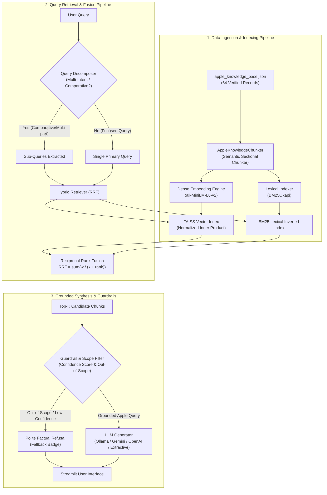

# System Architecture: Apple Genius AI RAG Assistant

## 1. Architectural Overview

The **Apple Genius AI RAG Assistant** is an enterprise-grade retrieval-augmented generation system engineered to provide factual, grounded technical support, device comparisons, store policies, and hardware troubleshooting.

---

## 2. Pipeline Design Decisions

### A. Semantic Sectional Chunking
* **Strategy:** Standard fixed-size chunking (e.g. 500 characters blindly sliced across token boundaries) breaks critical table rows, prices, and deductible clauses midway.
* **Our Approach:** `AppleKnowledgeChunker` generates 4 distinct, self-contained semantic units per product or policy record:
  1. **Overview Chunk**: Product persona, high-level summary, baseline MSRP.
  2. **Technical Specifications Chunk**: Processor architecture, displays, cameras, battery numbers, dimensions, and interfaces.
  3. **FAQs Chunk**: Direct question-and-answer pairs matching real customer language.
  4. **Policy & Terms Chunk**: Warranty limits, deductibles, exclusions, and statutory terms.
* **Benefit:** Retrieval candidates contain 100% semantic integrity without truncated sentences or missing clauses.

### B. Hybrid Retrieval via Reciprocal Rank Fusion (RRF)
* Dense semantic search (`all-MiniLM-L6-v2`) excels at conceptual matching (e.g. *"how to fix black unresponsive screen"* $\rightarrow$ *Force Restart Protocol*).
* Lexical search (`BM25Okapi`) excels at exact tokens, product codes, model revisions, and numerical values (e.g., *"M4 Pro"*, *"A18"*, *"$29"*, *"14-day"*).
* **Fusion Formula:**
  $$\text{Score}_{\text{RRF}}(d) = \frac{0.6}{60 + \text{rank}_{\text{dense}}(d)} + \frac{0.4}{60 + \text{rank}_{\text{sparse}}(d)}$$
* Standard smoothing parameter $k = 60$ ensures stable score scaling across both indexes.

### C. Query Decomposition RAG
* Handles comparative questions (e.g., *"Compare iPhone 16 and iPhone 16 Pro camera specs"*) or multi-topic questions (e.g., *"What is Apple's return policy and what does screen repair cost under AppleCare+?"*).
* Decomposes the prompt into isolated sub-queries, queries the index independently for each sub-topic, merges non-duplicate top hits, and provides a unified context packet to the synthesizer.

### D. Grounded Prompt Engineering & Out-of-Scope Fallback
* System prompt strictly enforces context conditioning: facts absent from retrieved documents trigger an explicit polite statement rather than hallucinating generic training data.
* Fallback guardrail detects competitor device inquiries (Samsung, Dell, Windows) or arbitrary non-Apple topics.
